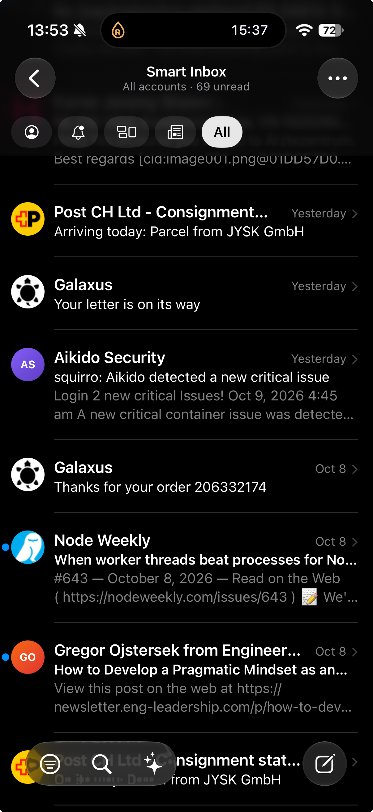
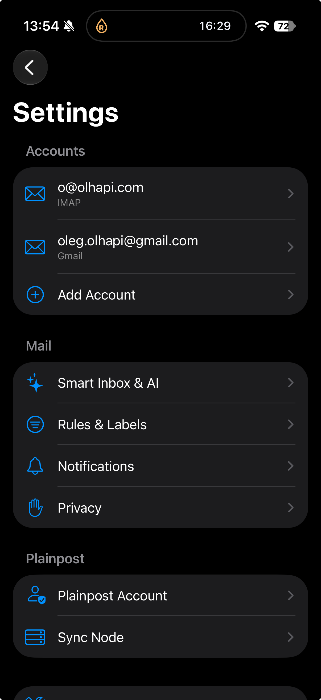

# Plainpost

Plainpost is a local-first mail app for macOS and iOS. It brings accounts,
search, drafts, organization, and optional local intelligence into one focused
mail experience while keeping mail data and credentials on your devices.

> Plainpost is source available here under the MIT license. Provider OAuth
> registrations, hosted services, and App Store distribution are not bundled
> with this repository.

## iOS and macOS

<p align="center">
  
  
  
</p>

Smart Inbox across every account, Ask Mail answering from your own mail with
the messages it used, and Settings with an IMAP and a Gmail account side by
side.


The iOS images are captures from an iPhone running Plainpost on the author's
own mailboxes. The macOS compose capture is generated by Plainpost's
design-snapshot target with synthetic fixture data.

## Features

- Connect standard IMAP/SMTP accounts and guided Google, Microsoft, and iCloud
  setups where provider credentials are configured.
- Keep mail metadata, local search, drafts, preferences, and audit records in
  a local SQLite store.
- Read conversations, compose drafts, manage attachments, reply and forward,
  and record Sent copies.
- Find mail with local full-text search and organize it with labels, rules,
  message actions, and Smart Inbox views.
- Use controlled send flows, approval queues, undo-send windows, and durable
  operation records to make delivery state explicit.
- Choose on-device or configured AI providers for optional summaries, search,
  classification, and draft assistance.
- Use the macOS browser bridge for supported local browser workflows.
- Add optional Sync Node capabilities when you operate compatible supporting
  infrastructure; ordinary direct mail does not require one.

## Build from source

Plainpost uses Swift Package Manager and Xcode projects for the platform apps.
The supported toolchain is Xcode 27 / Swift 6.2 on macOS 26 or later.

```sh
swift build
swift test
```

Open `Plainpost.xcodeproj` for the macOS app or
`Apps/PlainpostiOS/Plainpost.xcodeproj` for the iOS app. Local OAuth settings
belong in the ignored `Apps/PlainpostiOS/Config/LocalOAuth.xcconfig`; never
commit provider secrets.

## Privacy and prerequisites

Plainpost is designed around local storage and device credential protection.
Mail providers still require their own account credentials or OAuth client
configuration. Optional remote AI providers send only the requests you choose
to configure; review their terms before enabling them.

## Contributing

See [CONTRIBUTING.md](CONTRIBUTING.md). Please report security issues through
[SECURITY.md](SECURITY.md), not public issues.

## License

Plainpost is released under the [MIT License](LICENSE). Third-party notices are
listed in [NOTICE.md](NOTICE.md).
