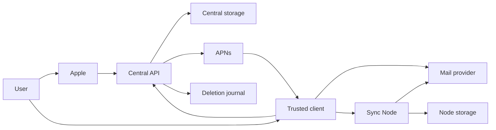

# Plainpost account sync threat model

## Executive summary

Plainpost's highest risks are integrity failures at identity-to-device trust,
compromise of a trusted client or Sync Node holding provider secrets, and
coordinator failures that cause trust rollback, APNs abuse, split-brain writes,
or deleted-account resurrection. The approved architecture keeps provider
credentials and mail plaintext outside the official central service, but that
boundary is only credible if an offline app-shipped root authenticates online
bootstrap keys, signed request correlation closes response substitution,
contiguous signed history preserves removals, account-key packages cover every
active survivor, metadata AEAD is interoperable and monotonic, recovery/restore
are atomic, notification replay is enforced, writer leases fence partitions,
and every route/storage boundary is tested independently.

## Scope and assumptions

In scope is the complete pre-implementation security gate in
`docs/superpowers/specs/2026-08-02-plainpost-account-device-sync-architecture.md`
under "Security Verification Gates": account/trust, Apple and provider
identity, clients and Sync Node, App Attest/APNs, writer coordination, provider
delivery uncertainty, central/node storage and secrets, backup/restore, and
LAN/Cloudflare/Tailscale/VPS metadata boundaries. The account-v1 schema and
canonical transcripts in `Protocol/account-v1/` are the binding Milestone 1
contract.

Current code is evidence of existing behavior, not evidence that the new
architecture is implemented. It still has QR-era `PairingInvitation`,
`PairingBootstrapRequest`, and `PairingAuthority` in
`Sources/PlainpostDeviceTransport/PlainpostDeviceTransport.swift`, CloudKit wake
code under `Sources/PlainpostDeviceSync/`, and no central Go service or Sync
Node at base commit `e9e71f8a`. Out of scope is build/CI tooling except its
ability to protect release artifacts and secrets; runtime, infrastructure, and
test-only controls are distinguished below.

The user already approved the architecture through prior grilling, and the
coordinating agent explicitly confirmed that context for this workflow. That
is why no duplicate assumption-validation pause was required. Residual
assumptions affecting rank are:

- Production uses the fixed official HTTPS service and managed EU/Swiss
  PostgreSQL described in the authoritative spec's "Public Contract" and
  "Hosting and Privacy" sections; federation and a browser admin portal are
  absent.
- Attackers may control networks, a central service/database, one client, a
  Sync Node, node host, VPS provider, or stale backup, but do not initially
  forge Apple/P-256 signatures or extract private keys from every healthy
  device-only Keychain.
- Apple-audience platform classification, device caps, App Attest counters, leases, deletion
  journals, and rate limits are server-enforced planned controls. They are not
  inferred from a client label or the schema alone.
- Clients connect either directly to a mail provider or to one user-controlled
  Sync Node; provider state remains authoritative. Evidence:
  `docs/superpowers/specs/2026-08-02-plainpost-account-device-sync-architecture.md`
  sections "Supported Product Modes" and "Safe Direct Fallback".
- The central service never receives usable provider credentials, mailbox
  plaintext, notification private keys, account matching keys, or Sync Node
  database keys. This is an architectural requirement in "Data Boundary", not
  a control proven by current Go code.

Open questions that can still change priority are production offline-root
cold-storage/app-update custody, the exact Apple audience/JWKS deployment
runbook, App Attest
counter transaction/rate thresholds, APNs and central abuse-control limits,
writer-lease timing, and operational proof that the deletion journal is
restored independently before serving traffic.

## System model

### Primary components

- Apple issues mandatory identity assertions; the planned central verifier
  validates them and stores only a keyed issuer/subject representation.
  Evidence: authoritative spec "Sign in with Apple" and Milestone 1 Task 3 in
  `docs/superpowers/plans/2026-08-03-plainpost-account-trust-clean-break.md`.
- macOS/iOS clients hold device, provider, matching, and notification private
  material. Existing credential redaction/storage patterns live in
  `Sources/PlainpostAccounts/AccountSetupService.swift` and
  `Sources/PlainpostMobileClient/MobileVault.swift`; account-v1 storage remains
  planned.
- The planned official central API validates identity/device sessions,
  coordinates opaque trust and metadata, fences writers, validates App Attest,
  and routes bounded ciphertext to APNs. Planned modules are enumerated under
  "Central Plainpost Service" and "Go Services" in the authoritative spec.
- A user-controlled Sync Node may hold provider credentials, full mail
  projection, attachments, a node master key, and notification production
  authority. Its planned secret/storage boundary is documented in the spec's
  "User-Controlled Plainpost Sync Node" section.
- Gmail, Microsoft, iCloud, and generic IMAP/SMTP providers are external
  authorities. The provider remains canonical, and delivery-uncertain SMTP
  sends are never automatically retried; current protocol vocabulary already
  includes `DeviceProtocolErrorCode.deliveryUncertain` in
  `Sources/PlainpostDeviceProtocol/DeviceProtocolModels.swift`.
- APNs receives centrally relayed opaque encrypted payloads. App Attest is a
  planned gate for production registration; evidence is the spec's
  "Configuration" and "Cryptography and APNs" sections.
- Central PostgreSQL/backups and node PostgreSQL/filesystem/S3/backups are
  distinct operator storage zones. Deletion markers use a durable journal
  outside the stale account-snapshot boundary.
- LAN discovery, direct HTTPS, Cloudflare Tunnel, Tailscale, and VPS routing
  expose different metadata and termination points; the accepted routes are
  listed in the spec's "Sync Node Enrollment and Connectivity" section.

### Data flows and trust boundaries

- User/Apple -> central identity verifier -> signed bootstrap challenge ->
  device finalize: Apple token/nonce cross HTTPS first, but no session is issued.
  The server maps the verified Apple audience to a platform class, and a
  root-manifest-authenticated online key signs provisional IDs, exact keys,
  derived platform, and the canonical exchange-request digest in a five-minute
  single-use challenge. The device correlates its current request and signs the
  complete challenge plus device-signed genesis only for genesis mode. Challenge
  consumption and activation are atomic. Protocol evidence:
  `Protocol/account-v1/account.schema.json` and `trust-transcript.md`.
- Client -> central account/session API: public keys, signed proofs, rotating
  credentials, leases, signed trust state, ciphertext, attestation assertions,
  and routing tokens cross HTTPS. Planned API code must cap bodies before
  decode, authenticate the explicit signer, and rate-limit each surface.
- Existing client -> untrusted relay -> pending client: both public bundles,
  nonces, expiry, encrypted account secrets, and signed trust records cross a
  coordinator that may substitute/replay data. Canonical matching and state
  transcripts provide end-to-end integrity; TLS alone is insufficient. Record
  authority is transition-specific: genesis self-signs, admission uses the
  matching prior active approver and exact stored pending authorization,
  recovery self-signs only with an exact live one-time Apple-derived
  authorization,
  and removals require a surviving prior-state signer and prior-record digest.
  Those rules apply to new or changed records; a byte-identical survivor
  inherits its exact verified predecessor authority even after the original
  signer becomes inactive.
- Trusted client -> central atomic commit/history store -> new or offline
  client: pages of at most 32 signed state commits, closed signed cursors/pages,
  and
  per-recipient encrypted key packages cross an untrusted store. Only one
  all-or-nothing state/package/head commit is accepted. A purpose-isolated
  manifest key binds each request cursor, account, frozen head, ordered commit
  digests, next cursor, terminal state, and half-open lifetime. Delivery
  signatures never replace chain verification; package coverage and commitment
  protect both 32-byte account keys.
  Every non-genesis device-signed state names the immediately prior atomic
  `commitDigest`, including recovery across epochs, so a successor cannot cross
  package-only forks with the same `stateDigest`.
- Client -> central opaque record store -> clients: AES-256-GCM envelopes and
  signed epoch/generation/trust/record revisions cross storage. Exact AAD,
  unique nonces, signer-state checks, and rollback/equivocation high-water
  values are client controls; the Go service never decrypts.
- Client process -> device Keychain/local database: private keys, provider
  credentials, session material, mail caches, and operation journals cross the
  OS storage boundary. Existing device-only use is evidenced by
  `MobileVault.swift`; new account records require separate device-only items.
- Client/Sync Node -> provider: OAuth/app-password/IMAP/SMTP traffic crosses a
  provider trust boundary. Provider responses and SMTP ambiguity drive local
  authoritative reconciliation, not central assumptions.
- Client/Sync Node -> central writer coordinator -> provider: opaque lease and
  fencing epochs determine which writer may mutate. Asymmetric partitions can
  leave two reachable paths; planned fencing and reconciliation are specified
  in "Safe Direct Fallback".
- iOS/producer -> central App Attest/APNs -> APNs/device extension: attestation,
  APNs token, bounded opaque ciphertext, replay ID, timing, and outcomes cross
  Apple/central boundaries. Planned validation is described in "Rich
  Notification System"; no current implementation exists.
- Sync Node -> PostgreSQL/filesystem/S3/backup: mail, attachment blobs,
  credentials, and encrypted backup artifacts cross user-controlled storage
  and host-provider boundaries. Node master keys remain outside images,
  databases, repositories, and logs per "Secrets and Restart".
- Restore operator -> central snapshot -> deletion-journal replay -> API
  readiness: restore the stale snapshot first, then replay durable deletion
  markers from outside that snapshot, and only then serve traffic. Reversing
  this order can resurrect an account.
- Client -> LAN/Cloudflare/Tailscale/VPS -> Sync Node: outer transport protects
  links, while intermediaries may observe source/destination, timing, paths,
  sizes, and availability. End-to-end device/node authentication remains
  required after discovery or tunnel termination.

#### Diagram

## Assets and security objectives

| Asset | Why it matters | Security objective (C/I/A) |
| --- | --- | --- |
| Apple/provider identity assertions | Bootstrap account ownership and mailbox access. | C/I |
| Device, provider, matching, notification, and node private keys | Authorize access or decrypt sensitive state. | C/I |
| Refresh credentials, offline leases, App Attest counters, APNs tokens | Sustain account/session/notification authorization. | C/I |
| Bootstrap signing keys and single-use challenge records | Bridge validated Apple identity to device-signed genesis without server trust forgery. | I/A |
| Offline bootstrap root and monotonic online-key manifests | Prevent a compromised central database/service from inventing bootstrap or pagination keys. | I/A |
| Complete paged signed trust history and high-water state | Defines current authority and preserves every removed/suspended/recovered tombstone. | I/A |
| Account matching/metadata key generations and recipient packages | Preserve private mailbox identity and encrypted metadata while excluding removed devices. | C/I/A |
| Encrypted account-record nonce and revision state | Prevent metadata plaintext disclosure, nonce catastrophe, rollback, or equivocation. | C/I |
| Writer leases, fencing epochs, operation journals | Prevent conflicting mutations and duplicate sends. | I/A |
| Mail, attachments, local/node databases, encrypted backups | Contain user content and durable state. | C/I/A |
| Deletion journal and revocation records | Prevent restoration of deleted or revoked authority. | I/A |
| Entitlements, quotas, rate limits, security events | Bound abuse and provide detection without secret leakage. | I/C/A |
| Network and operational metadata | Reveals account/node activity, topology, timing, and volumes. | C |

## Attacker model

### Capabilities

- Submit malformed, oversized, replayed, concurrent, or reordered traffic to
  public central and exposed Sync Node endpoints.
- Observe, delay, drop, splice, or terminate traffic at a LAN, Cloudflare,
  Tailscale, ISP, APNs, or VPS boundary according to that operator's position.
- Compromise a client, Sync Node, central service/database, object/attachment
  store, backup, mounted secret, APNs token, Apple/provider session, or restore
  operator credential; each has a different blast radius.
- Race App Attest counters, device additions, token rotation, writer leases,
  restore, and security-state updates.
- Operate a formerly trusted device or stale snapshot and replay valid old
  signatures/ciphertext without forging new signatures.

### Non-capabilities

- No assumed break of Apple signatures, P-256, SHA-256, HMAC/HKDF, AES-GCM,
  TLS, or APNs itself.
- A network/central attacker does not automatically obtain private account,
  provider, notification, or node keys; endpoints that legitimately possess
  them are modeled separately as compromise cases.
- The central service is not assumed to process plaintext mail or provider
  secrets. Any implementation that introduces that data flow violates the
  approved boundary and raises severity beyond this model.
- App Attest is not treated as proof that a whole client is uncompromised; it
  is one registration/assertion signal subject to counter and replay handling.

## Entry points and attack surfaces

| Surface | How reached | Trust boundary | Notes | Evidence (repo path / symbol) |
| --- | --- | --- | --- | --- |
| Apple exchange/bootstrap finalize | Public central API, planned | Internet -> identity verifier/session activation | Exchange validates token/key proof but issues no session; signed single-use challenge and device finalize bind provisional IDs, mode, bundle, and the atomic genesis commit. | `Protocol/account-v1/account.schema.json`; Milestone 1 Task 3 plan |
| Bootstrap manifest refresh | Bundled asset/pre-auth well-known central API, planned | App update offline root -> online purpose keys | Each manifest is directly root-signed; half-open validity, purpose/status, version/digest high-water; optional predecessor digest is audit-only; response is current plus max-four overlap; root rotation requires app update. | `Protocol/account-v1/trust-transcript.md`; Milestone 1 Tasks 2-4 plan |
| Session refresh and lease | Public central API, planned | Internet -> device auth | Device proof, rotating credential, replay nonce, expiry. | Architecture "Device-Bound Sessions"; Milestone 1 Task 5 plan |
| Trust state commits/history | Public central API, planned | Devices -> untrusted coordinator/storage | Active-only membership, signed transitions, bounded commit pages, exact survivor package coverage, atomic state/package/head persistence. | `Protocol/account-v1/trust-transcript.md`; Milestone 1 Tasks 6-7 |
| Encrypted account records | Public central API, planned | Clients -> opaque storage -> clients | Exact AEAD AAD, nonce/envelope bounds, signer and generation/revision high-water. | `Protocol/account-v1/trust-transcript.md`; Milestone 1 Tasks 6-7 |
| Recovery/revoke/delete/restore | Central lifecycle API/operator workflow, planned | High privilege -> account state/storage | Apple/biometric step-up, epoch change, external marker journal. | Architecture "Recovery"/"Account Deletion"; Milestone 1 Task 9 |
| App Attest registration | Public central API, planned | iOS/Apple -> attestation service | Counter races, replay, environment segregation. | Architecture "Autonomous iOS", "Rich Notification System / Configuration", and "Go Services"; encrypted-notifications plan |
| APNs submit/extension | Producer -> central -> APNs -> device, planned | Multiple service/device zones | Token secrecy, key substitution, payload/replay/expiry bounds. | Architecture "Cryptography and APNs" and "Go Services" |
| Provider OAuth/IMAP/SMTP | Client or node -> provider | Secret-holding endpoint -> provider | Stolen identity, TLS/auth, delivery ambiguity. | `Sources/PlainpostAccounts/AccountSetupService.swift`; architecture "Mail Provider Authentication" |
| Writer coordination/fallback | Client/node -> central -> provider, planned | Partitioned writers -> authority | Lease fencing and reconciliation under asymmetric reachability. | Architecture "Safe Direct Fallback"; fallback plan |
| Node client API/admin commands | LAN/tunnel/VPS routes, planned | Client/operator -> user-controlled node | End-to-end auth after discovery/tunnel; no browser admin. | Architecture "Sync Node Enrollment and Connectivity" and "Deployment Portability" |
| Node storage/backup | Local PostgreSQL/filesystem/S3/mounted secrets, planned | Node -> host/storage provider | Full mail, attachments, credentials, keys, retention. | Architecture "Persistence"/"Secrets and Restart"; sync-node plan |
| Legacy QR bootstrap | Current LAN app | Unauthenticated phone -> Mac | Must be removed; current default capabilities are not account trust. | `PlainpostDeviceTransport.swift` `PairingAuthority.accept` |

## Top abuse paths

1. A compromised coordinator substitutes a pending key -> weak transcript/state
   verification accepts it -> attacker receives group secrets (TM-001/TM-002).
2. A captured Apple token or refresh credential is replayed -> nonce/device
   proof/rotation is missing -> attacker activates or sustains access
   (TM-003/TM-004).
3. A stale/reordered history page or cursor is served -> client accepts a head
   without every transition -> removed authority returns (TM-005/TM-018).
4. A key package is omitted/substituted or still sent to a removed device ->
   rotation does not exclude it or survivors lose access (TM-019).
5. A stale signed graph or backup is served -> client/restore accepts lower
   state or fails to replay deletion journal -> revoked/deleted authority returns
   (TM-005/TM-008).
6. An Apple-session attacker invokes recovery -> old sessions are not atomically
   suspended -> two trust epochs remain usable (TM-006).
7. Concurrent additions bypass a cap, or an untrusted audience/platform claim
   is accepted -> excess devices or a fake Sync Node gain authority
   (TM-007).
8. Metadata AES-GCM nonce reuse or generation/revision rollback is accepted ->
   metadata confidentiality or integrity fails (TM-020).
9. A compromised client/Sync Node steals provider identity and signs malicious
   operations -> provider mail/content is exposed or mutated (TM-010).
10. Attestation counters or APNs replay/key/token handling is raced -> attacker
   registers a route, leaks routing material, or sends malicious payloads
   (TM-011/TM-012).
11. A partition lets node and direct client both write -> stale fencing or an
   automatic SMTP retry duplicates/conflicts delivery (TM-013/TM-014).
12. A node database, attachment store, backup, or mounted secret is stolen ->
   attacker obtains content or keys beyond central-service privacy claims
   (TM-015).
13. LAN/Cloudflare/Tailscale/VPS metadata or termination is mistaken for
    end-to-end trust -> traffic analysis or endpoint impersonation follows
    (TM-016).

## Threat model table

| Threat ID | Threat source | Prerequisites | Threat action | Impact | Impacted assets | Existing controls (evidence) | Gaps | Recommended mitigations | Detection ideas | Likelihood | Impact severity | Priority |
| --- | --- | --- | --- | --- | --- | --- | --- | --- | --- | --- | --- | --- |
| TM-001 | Compromised central relay | Can alter public handshake, pending authorization, or record material. | Substitute device keys/platform, cross account/epoch records, unauthorized new/changed self-signers, or mutate a survivor after its original signer becomes inactive. | Join trust or deny admission. | Trust graph, account secrets | Planned only: matching transcript binds both IDs/keys/nonces/expiry; admission binds the exact stored pending account/device/audience-derived platform/bundle; transition-specific authority applies to new/changed records while exact byte-identical survivors inherit verified predecessor authority (`trust-transcript.md`). | Runtime absent. | Compare SAS once; bind pending authorization digest into signed admission; reject class/key/ID/cross-authorization mismatch before CAS; require predecessor-byte equality for survivors and current-transition authority for every new/changed record. | Key/class change, cross-authorization, survivor-mutation, and signer-authority rejection events. | Medium | High | high |
| TM-002 | Network MITM | Can splice/delay trust relay. | Reorder roles, replay, downgrade, or exploit ambiguous encoding. | False approval. | Trust graph | Existing legacy TLS pinning in `PlainpostDeviceTransport.swift`; planned canonical account transcript supersedes it. | QR bootstrap remains; account flow absent. | Exact LP encoding, expiry, one attempt, no protocol downgrade, cross-language/fuzz vectors. | Mismatch, expiry, downgrade metrics. | Medium | High | high |
| TM-003 | Apple-token/challenge thief | Captures a valid JWT or bootstrap message. | Replay exchange/finalize, swap responses, or substitute IDs/mode/keys. | Account takeover/pending device. | Identity, sessions, bootstrap challenges | Planned: proof plus canonical request digest is bound into root-manifest-authenticated challenge and finalize. | Verifier/challenge transaction absent. | Apple JWKS/nonce/audience checks; no pre-finalize session; client request correlation; atomic one-time consumption; raw-token ban. | Token-digest reuse, response-digest mismatch, challenge replay, and verifier-failure alerts. | Medium | High | high |
| TM-004 | Refresh thief | Obtains credential. | Refresh elsewhere or reuse old generation. | Persistent access. | Sessions, leases | Planned only: device proof, rotation, 15-minute access and 30-day lease in Milestone 1 Task 5. | No service. | Argon2id hashes, single-use rotation, family revoke on reuse, proof nonce store. | Refresh reuse/family revocation events. | Medium | High | high |
| TM-005 | Central/storage attacker | Has older valid commits or can vary packages around one signed state. | Roll back epoch/revision, create package-only forks A/B with one `stateDigest`, then splice a successor C signed for the other fork. | Removed authority returns or clients accept different key delivery. | Trust/revocation/packages | Planned every non-genesis state device-signs exact `previousCommitDigest`; checkpoint is `(accountID, epoch, revision, commitDigest)` (`trust-transcript.md`). | Client chain store absent. | Verify contiguous complete commits and predecessor-commit equality, including recovery across epochs; reject C-from-A when checkpoint/history ends at B even if A/B share `stateDigest`. | Rollback, predecessor-commit, package-equivocation, and commit-digest mismatch counters. | Medium | High | high |
| TM-006 | Apple-session attacker | Fresh Apple auth, recovery surface. | Reuse/cross-wire recovery authorization, change audience-derived platform/bundle, create Sync Node recovery, or recover without prior-commit linkage and atomic suspension. | Full takeover, split epoch, or old-key reuse. | Trust, matching/metadata/notification keys | Planned purpose-key-signed short-lived one-time recovery authorization binds account/new epoch/replacement ID/platform/bundle/exchange digest; state binds prior `commitDigest`. | No atomic implementation. | Verify/consume exact authorization before CAS; forbid `sync_node`; suspend all old sessions/leases; fresh two-key material; exactly one replacement package; verify prior head and max-11 transition. | Authorization reuse/class/cross-binding, recovery, old-session use, and prior-generation alerts. | Low | High | high |
| TM-007 | Authenticated/racing client | Valid session and concurrent adds. | Supply platform, cross-wire a pending authorization, abuse unknown Apple audience, bootstrap a node, or exceed cap. | Expanded authority/cost. | Entitlements, trust | Planned immutable Apple audience mapping, canonical pending authorization binding, and enrollment-only `sync_node`; signed records bind derived class. | Server mapping/transaction absent. | Reject client platform, class/key/ID/digest mismatch, and unknown audience before CAS; serializable 5 macOS/5 combined iOS/1 node transaction; encrypted iPad label only. | Audience/class/cross-authorization rejection, cap race, and node-bootstrap alerts. | Medium | Medium | medium |
| TM-008 | Restore operator/storage attacker | Stale snapshot after deletion. | Restore account without durable marker replay. | Account/session resurrection. | Deletion, revocation | Planned 30-day retention and marker rule in architecture/Task 9. | External journal/restore gate unimplemented. | Keep deletion journal outside snapshot; restore snapshot first; replay markers; block readiness until complete; test stale resurrection. | Audited marker high-water and blocked restores. | Low | High | high |
| TM-009 | Malicious authenticated device | Can upload metadata/state. | Oversized/deep/duplicate inputs. | API/storage exhaustion. | Availability | Existing legacy 4 MiB frame cap in `DeviceProtocol.maximumTransportFrameBytes`; account schema is bounded. | Semantic decoded limits not implemented. | Pre-decode body cap, canonical base64 decode limits, unique members, quota/rate limiting, fuzzing. | Size buckets and quota alerts. | High | Medium | medium |
| TM-010 | Compromised client or Sync Node / stolen provider identity | Endpoint legitimately has provider credentials. | Exfiltrate tokens/mail or issue provider mutations. | Mail disclosure/deletion/send abuse. | Provider identity, mail | Existing credential abstraction/redaction in `AccountSetupService.swift`; planned device-only/node secret isolation. | Endpoint compromise bypasses central privacy. | Least-scope device-specific provider tokens, device revocation, node hardening, provider audit/revocation, content-safe logs. | Provider auth anomaly and unexpected mutation alerts. | Medium | High | high |
| TM-011 | Attestation attacker/racer | Can replay assertions or race counters/environment. | Register unauthorized notification route. | Route abuse or notification loss. | Attestation, APNs registration | Planned App Attest mandatory rule in architecture "Autonomous iOS" and "Rich Notification System / Configuration". | Verifier/counter transaction absent. | Verify chain/app/environment/challenge; atomic monotonic counter; dev/prod separation; replay/race tests. | Counter rollback/duplicate/challenge failure metrics. | Medium | High | high |
| TM-012 | APNs/relay attacker | Token/key/payload/replay surface access. | Substitute recipient key, leak token, replay or oversize ciphertext. | Privacy loss, spoofing, DoS. | APNs tokens, notification content | Planned signed recipient key, AEAD, replay/expiry/size/idempotency in architecture "Cryptography and APNs". | Modules absent. | Verify trust signature, bind associated data, cap/rate/idempotency, keyed token logging only, generic fallback. | Replay, token invalidation, payload rejection and APNs reason alerts. | Medium | High | high |
| TM-013 | Partitioned clients/node/coordinator | Asymmetric network reachability. | Two writers use stale authority. | Conflicting mutations or duplicate side effects. | Writer lease, provider state | Planned provider authority and fencing in "Safe Direct Fallback". | Lease service/chaos evidence absent. | Monotonic fencing epoch checked at mutation boundary; read-only fallback until lease; signed journal reconciliation. | Overlapping lease and stale-fence rejection alerts. | Medium | High | high |
| TM-014 | Provider/network ambiguity | SMTP connection fails after possible acceptance. | Automatically retry uncertain send. | Duplicate mail. | Operation journal, provider state | Existing `deliveryUncertain` protocol state; architecture explicitly forbids automatic retry. | End-to-end provider implementation incomplete. | Durable idempotency context; surface uncertainty; reconcile via Sent/provider ID; human decision before retry. | Delivery-uncertain rates and repeated message-ID checks. | Medium | High | high |
| TM-015 | DB/object/backup/secret attacker | Accesses central or node storage/host secrets. | Steal/alter DB, attachments, backups, node/APNs/Apple keys. | Broad confidentiality/integrity loss. | Mail, attachments, keys, backups | Planned node key outside DB/image/log and encrypted backups in architecture "Persistence"/"Secrets and Restart". | Runtime/runbooks absent. | Separate mounted/KMS secrets, envelope-encrypted backups, manifest/digest restore checks, least privilege, retention/purge, rotation drills. | Storage access, restore digest, key-use and purge audit. | Medium | High | high |
| TM-016 | LAN/Cloudflare/Tailscale/VPS observer or terminator | Controls a route/intermediary. | Correlate metadata, redirect endpoint, or exploit assumed tunnel trust. | Privacy loss or impersonation. | Metadata, endpoint trust | Existing local Network.framework TLS listener/pinning; planned end-to-end node auth across routes. | Routes not implemented/tested. | Authenticate node/device above tunnel, pin account endpoint identity, document visible metadata, minimize labels, test every route. | Endpoint identity changes and route anomaly metrics. | Medium | High | high |
| TM-017 | Compromised central service/database | Can replace online keys or serve stale manifests but lacks offline root. | Introduce attacker bootstrap/pagination/recovery-authorization key, roll back/equivocate a manifest, or reuse a revoked/wrong-purpose key. | Scalable bootstrap/recovery impersonation or forged delivery metadata. | Offline root, online keys, account identity/history delivery | Planned closed directly root-signed manifests, app-shipped root, version/digest high-water, half-open purpose/status/validity checks, and bounded pre-auth current-plus-overlap distribution. | Root custody, client store, distribution controls, and rotation runbook unimplemented. | Keep root offline; isolate all three online purposes; accept any strictly higher signed version; treat manifest predecessor as audit-only; fail closed on unknown root/rollback/equivocation/expiry/revocation/wrong purpose. | Manifest digest/version fleet telemetry and unexpected key-purpose use alerts. | Medium | High | high |
| TM-018 | Central history store attacker | Can omit/reorder pages or mint valid delivery signatures through compromised service. | Hide a removal, skip a gap, substitute fork B for A then deliver successor C signed for A, change frozen head, forge terminal state, or cause cursor-expiry rollback. | Stale or equivocated authority accepted. | Trust history, revocation, packages | Planned max-32 closed signed pages/cursors bind exact commit heads/digests; each non-genesis state independently signs exact prior `commitDigest`; delivery signatures carry no trust authority. | Paging implementation absent. | Verify every complete commit from persisted tuple; require `state.previousCommitDigest == acceptedHead.commitDigest`; enforce page bounds and reject gaps/reorder/duplicates/forks/head drift/premature terminal; restart persisted high-water on expiry. | Page-chain, predecessor-commit, cursor-expiry restart, terminal-rule, and inconsistent-head metrics. | Medium | High | high |
| TM-019 | Malicious state signer or package store | Can omit, duplicate, substitute, or retain a recipient package, vary package bytes at an existing state coordinate, or fail between writes. | Deny survivor keys, leak rotated keys to removed device, persist a partial generation, or exploit state-only idempotency. | Metadata/mailbox privacy loss or account DoS. | Matching/metadata keys, active membership | Planned `TrustStateCommitV1` finalizes state first, binds exact one-package-per-member set, derives complete `commitDigest`, and atomically advances state/packages/head. | Runtime transaction absent. | Reject standalone writes; key CAS/idempotency by complete commit tuple; verify sorted coverage/shared metadata/authorized signer before transaction; reject differing equal-coordinate commit bytes even with identical `stateDigest`; roll back all rows/head on failure. | Partial commit, recipient mismatch, equal-state/different-commit, commitment mismatch, and generation-coverage alerts. | Medium | High | high |
| TM-020 | Compromised client/storage attacker | Can upload/replay envelopes or cause nonce misuse. | Reuse AES-GCM nonce, alter AAD fields, roll back generation/revision, or equivocate. | Metadata disclosure/forgery or stale policy. | Encrypted account metadata | Planned exact nonce-envelope/AAD/signature and per-record high-water in `trust-transcript.md`; shared Swift/Go vector. | Client crypto/runtime absent; server is intentionally opaque. | Cryptographic RNG with local nonce-reuse guard; no compression; signer-state/generation checks; exact vector/fuzz tests; re-encrypt on rotation. | Duplicate nonce per generation, rollback/equivocation, tag/signature failure alerts. | Medium | High | high |

### Recovery right after sign-in (2026-10-08)

A device that signs in to an existing account and then recovers it reuses
the Apple sign-in it just completed. The token and raw nonce stay in memory
only, for nine minutes; Central accepts an Apple identity token for ten
minutes after `iat`. Recovery still binds the proof to the replacement
device's own key (`ExchangeProofTranscript`) and asks for local confirmation.
This relies on Central having no cross-endpoint Apple nonce ledger:
bootstrap's `UNIQUE (identity_digest, exchange_nonce)` covers bootstrap begin
only. A future global replay ledger must allow exactly one bootstrap-begin to
recovery-prepare handoff per identity, nonce and device bundle, or recovery
falls back to a second Apple prompt. The existing gap noted under TM-006
still applies: a leaked token and nonce pair is usable by any bundle within
the window, because the nonce is random rather than derived from the device
key.

## Criticality calibration

- **critical:** unauthenticated scalable account takeover, central/provider key
  theft across many users, or central receipt of plaintext provider credentials
  and mail. Examples: accepting arbitrary Apple signatures; universal device
  proof bypass; exposed production APNs/provider signing secrets.
- **high:** compromise of one account's trust/provider/session/deletion
  integrity or a broadly exploitable privileged boundary. Examples: key
  substitution that passes approval; node master-key theft; split-brain
  duplicate sends; recovery that leaves old sessions usable.
- **medium:** bounded availability/integrity harm needing an authenticated
  device or limited operator position. Examples: metadata resource exhaustion;
  transactional device-cap race; route metadata disclosure without content.
- **low:** limited, recoverable disclosure or denial under unusual local
  preconditions. Examples: redacted protocol-version leakage; an expired
  pending notice; noisy invalid-route attempts blocked by endpoint auth.

## Focus paths for security review

| Path | Why it matters | Related Threat IDs |
| --- | --- | --- |
| `Protocol/account-v1/` | Root manifests, request correlation, signed history, packages, metadata envelopes, bounds, and cross-language vectors. | TM-001-TM-009, TM-017-TM-020 |
| `Sources/PlainpostAccountRuntime/` | Planned manifest high-water, device-only sessions/keys, paged trust verification, package/record crypto, and recovery. | TM-001-TM-007, TM-017-TM-020 |
| `Services/PlainpostGo/internal/central/appleidentity/` | Planned Apple JWT/JWKS/nonce verifier. | TM-003, TM-006 |
| `Services/PlainpostGo/internal/central/deviceauth/` | Planned refresh/lease/proof rotation and replay fencing. | TM-004, TM-005 |
| `Services/PlainpostGo/internal/central/trust/` | Planned active state, transition/history pages, caps, package coverage, recovery, and monotonic persistence. | TM-001, TM-005-TM-009, TM-018, TM-019 |
| `Services/PlainpostGo/internal/central/metadata/` | Planned opaque bounded record CRUD and monotonic signature checks. | TM-009, TM-020 |
| `Services/PlainpostGo/internal/central/notification/` | Planned App Attest, APNs route, replay, key, and payload controls. | TM-011, TM-012 |
| `Services/PlainpostGo/internal/central/postgres/` | Planned account, replay, deletion journal, and restore transactions. | TM-004-TM-009, TM-015 |
| `Sources/PlainpostProviderAuth/` | Planned provider token acquisition/storage across direct clients and node. | TM-010, TM-014 |
| `Sources/PlainpostDirectMail/` | Planned provider authority, writer fencing, journals, and delivery uncertainty. | TM-013, TM-014 |
| `Services/PlainpostGo/internal/node/` | Planned mail/attachment/secret/storage/tunnel trust boundary. | TM-010, TM-013-TM-016 |
| `Deploy/central/` | Planned managed database, backup/restore, secrets, readiness, and retention. | TM-008, TM-011, TM-012, TM-015 |
| `Deploy/sync-node/` | Planned LAN/Cloudflare/Tailscale/VPS/storage/backup configuration. | TM-010, TM-013, TM-015, TM-016 |
| `Sources/PlainpostDeviceTransport/PlainpostDeviceTransport.swift` | Current QR bootstrap and TLS behavior must be removed/replaced without bypass. | TM-001, TM-002, TM-016 |
| `Sources/PlainpostMobileClient/MobileVault.swift` | Existing device-only storage pattern and compromise boundary. | TM-004, TM-010, TM-015 |
| `Sources/PlainpostDeviceProtocol/DeviceProtocolModels.swift` | Existing delivery-uncertain state that future provider flows must preserve. | TM-014 |

## Quality check

- Covered every security-gate topic in the architecture's "Failure and
  User-State Model" and "Deep Module Boundaries" sections and represented each
  discovered trust boundary in at least one threat.
- Separated existing Swift controls from planned Swift/Go/infrastructure
  controls and from test/release requirements.
- Grounded runtime/deployment claims in repository paths or named sections of
  the approved architecture and plans; absent future paths are labeled planned.
- Recorded the approved prior grilling as the reason no duplicate context pause
  occurred and retained residual assumptions/open questions.
- Included central/client/node/provider/APNs/storage/backup/network compromise,
  replay, rollback, recovery, cap, restore, partition, delivery, and resource
  abuse paths with concrete mitigations and detection.
- Covered offline-root/manifest trust, exchange correlation, paged tombstone
  history, active-only lifecycle, two-key rotation/package coverage, portable
  UInt64 parsing, and interoperable metadata AEAD as explicit planned controls.
